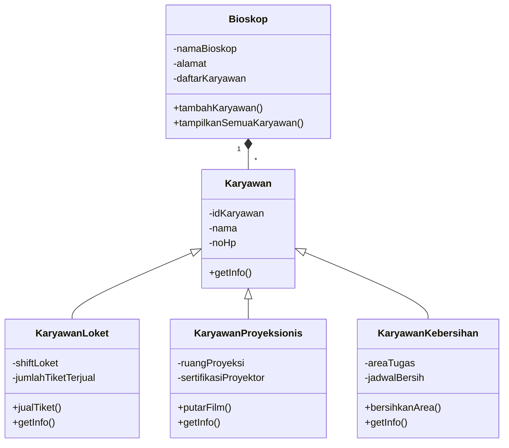
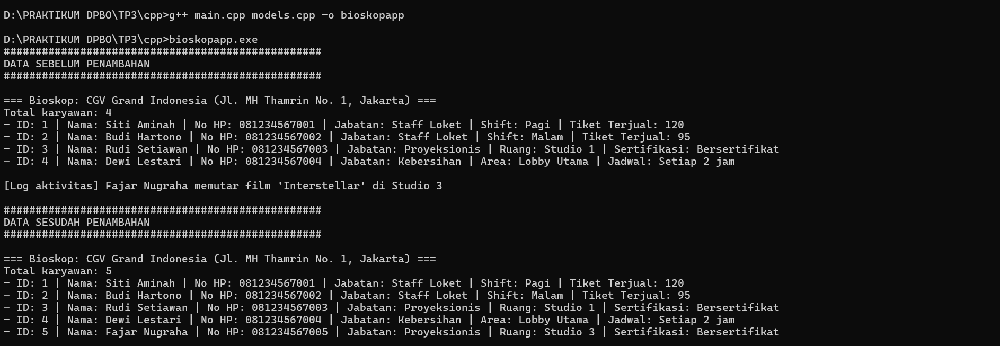
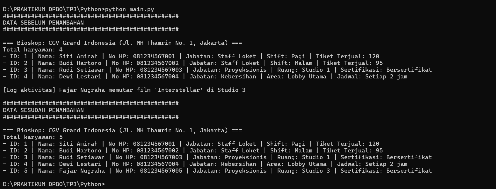

# Manajemen Karyawan Bioskop - Hierarchical Inheritance & Composition

Program OOP yang mengelola data karyawan di sebuah bioskop, menggabungkan
dua konsep sekaligus: **Hierarchical Inheritance** dan **Composition**
(dengan **Array of Object**). Diimplementasikan dalam **C++** dan **Python**.

---

## Janji
> Saya Ahmad Jadzil Rizki dengan NIM 2501839 mengerjakan TP3 dalam
> mata kuliah Desain Pemrograman Berorientasi Objek untuk keberkahanNya maka saya tidak
> melakukan kecurangan seperti yang telah dispesifikasikan. Aamiin.

---

## Desain Diagram



Panah `<|--` menunjukkan **inheritance** (Karyawan adalah parent dari 3
class anak). Panah `*--` menunjukkan **composition** (Bioskop memiliki
banyak Karyawan, ikatan kuat — bukan is-a, melainkan has-a).

---

## Penjelasan Atribut & Method

| Class | Atribut | Method | Keterangan |
|---|---|---|---|
| `Karyawan` (parent) | idKaryawan, nama, noHp | getInfo() | Data dasar yang dimiliki semua jenis karyawan |
| `KaryawanLoket` (child) | shiftLoket, jumlahTiketTerjual | jualTiket(), getInfo() (override) | Karyawan yang bertugas di loket penjualan tiket |
| `KaryawanProyeksionis` (child) | ruangProyeksi, sertifikasiProyektor | putarFilm(), getInfo() (override) | Karyawan yang mengoperasikan proyektor film |
| `KaryawanKebersihan` (child) | areaTugas, jadwalBersih | bersihkanArea(), getInfo() (override) | Karyawan yang bertanggung jawab atas kebersihan area tertentu |
| `Bioskop` (composition) | namaBioskop, alamat, daftarKaryawan | tambahKaryawan(), tampilkanSemuaKaryawan() | Memiliki banyak object Karyawan (array of object) |

Semua atribut bersifat **private** dan diakses lewat getter. Setter hanya
disediakan untuk `noHp` (`setNoHp()` / `set_no_hp()`).

Method `getInfo()` di-override di tiap class anak: versi parent-nya
dipanggil dulu (`super().get_info()` di Python, `Karyawan::getInfo()` di
C++), baru ditambah info khusus jabatannya sendiri.

---

## Penjelasan Desain Program

**Hierarchical Inheritance** — `Karyawan` adalah satu parent yang
diturunkan ke 3 class anak sekaligus (`KaryawanLoket`,
`KaryawanProyeksionis`, `KaryawanKebersihan`). Dari sudut pandang
masing-masing anak, ini tetap single inheritance; yang membuatnya
hierarchical adalah satu parent dipakai oleh banyak anak berbeda.
Hubungan ini bersifat **is-a** — `KaryawanLoket` **adalah** `Karyawan`.

**Composition** — `Bioskop` **memiliki** banyak object `Karyawan`
(hubungan **has-a**, bukan is-a). `Bioskop` juga bertanggung jawab atas
siklus hidup karyawan-karyawan tersebut: kalau object `Bioskop`
dihancurkan, semua karyawan di dalamnya ikut dihapus (di versi C++, ini
dibuktikan lewat destructor `Bioskop` yang menghapus semua `Karyawan*`
di dalamnya). Ini beda dengan Agregasi yang ikatannya lebih lemah.

**Array of Object** — atribut `daftarKaryawan` di `Bioskop` adalah
kumpulan (`list` di Python, `vector<Karyawan*>` di C++) yang menampung
campuran `KaryawanLoket`, `KaryawanProyeksionis`, dan `KaryawanKebersihan`
sekaligus. Ini juga menjadi contoh **polymorphism**: satu pemanggilan
`getInfo()` pada tiap elemen array menghasilkan output berbeda, tergantung
jenis karyawannya (di C++ ini berjalan karena `getInfo()` bersifat
`virtual`).

---

## Penjelasan Alur Program

Alur ini sama persis di kedua bahasa (C++ dan Python):

1. **Inisialisasi** — membuat satu object `Bioskop`.
2. **Tambah data awal** — menambahkan 4 object karyawan (campuran
   `KaryawanLoket`, `KaryawanProyeksionis`, `KaryawanKebersihan`) ke
   dalam `Bioskop` secara statis lewat kode.
3. **Tampilkan data SEBELUM** — memanggil `tampilkanSemuaKaryawan()`
   untuk menampilkan seluruh data yang ada saat itu (4 karyawan).
4. **Tambah 1 data baru** — satu object `KaryawanProyeksionis` baru
   ditambahkan ke `Bioskop`, lalu method khususnya `putarFilm()` dipanggil
   sebagai demo dan hasilnya dicetak sebagai log aktivitas.
5. **Tampilkan data SESUDAH** — memanggil `tampilkanSemuaKaryawan()`
   lagi, menunjukkan total karyawan bertambah jadi 5.

---

## Cara Menjalankan

### C++
```bash
cd CPP/Program
g++ main.cpp models.cpp -o bioskopapp
```

Lalu jalankan:
- Windows: `bioskopapp.exe`
- Linux / macOS: `./bioskopapp`

### Python
```bash
cd Python/Program
python main.py
```

---

## Struktur Folder

```
TP3DPBO2526C2
├── CPP/
│   ├── Program/
│   │   ├── models.h
│   │   ├── models.cpp
│   │   └── main.cpp
│   └── Dokumentasi/
│       └── cpp1.png
├── Python/
│   ├── Program/
│   │   ├── models.py
│   │   └── main.py
│   └── Dokumentasi/
│       └── python1.png
└── README.md
```

---

## Dokumentasi

### C++



### Python

